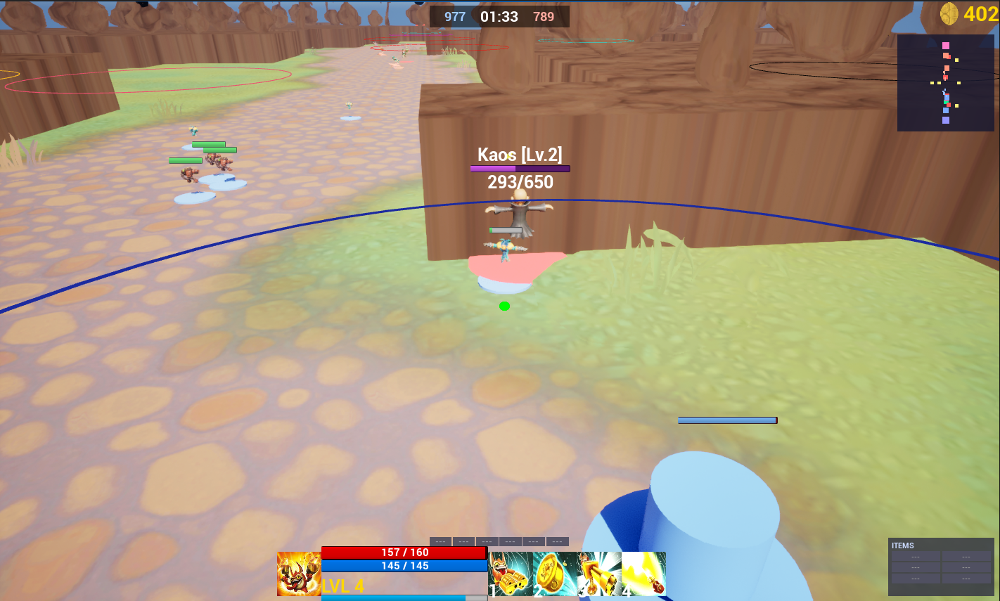
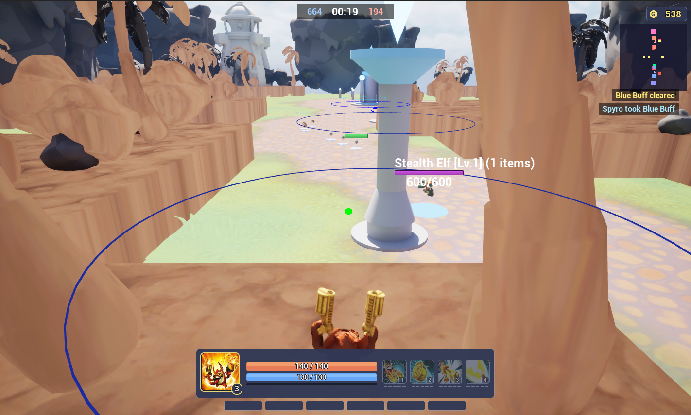
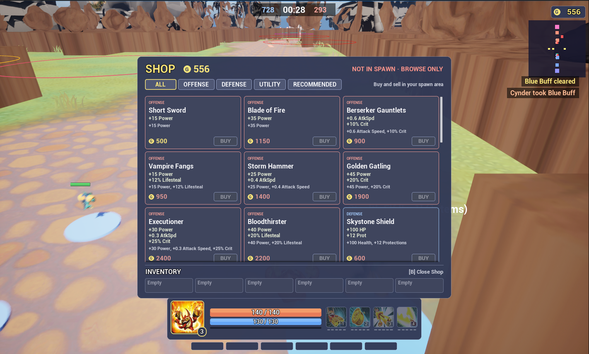
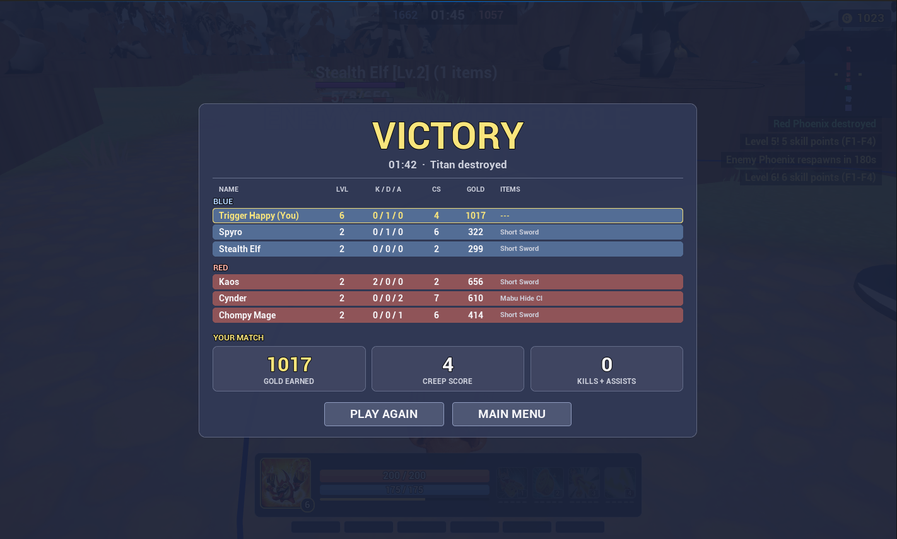

# Skylanders Conquest

A SMITE-style 3v3 MOBA prototype built in Unreal Engine 5.8 with real Skylanders
characters, pulled from a personally owned copy of *Skylanders Imaginators* through
an extraction pipeline this project had to build along the way.



It is a personal prototype. The goal is **one match that feels like a real game**,
played solo against bots. Networking is deliberately last.

## What's in a match

- **3v3 with bots.** You plus two AI allies against three AI gods. Gods lane,
  last-hit, duel, take jungle buffs, back off towers with hysteresis, focus
  the lowest-health hero, and join your fights. Kills and assists are
  credited to whoever earned them.
- **Full MOBA loop.** Towers, phoenixes and titans built as stepped stone
  structures with glowing team crystals, two minion waves, jungle buff camps
  with a boss, gold and XP, 500 starting gold, a 36-item shop with cooldown
  reduction, penetration and a recommended build per god, ability leveling,
  recall, respawn timers that scale with match time, and an end-of-match
  results screen with both teams' stats.
- **Four playable Skylanders.** Trigger Happy (ranged crit), Hex (burst mage),
  Tree Rex (tank) and Spyro (bruiser: Flame Breath, Charge, Comet Dash,
  Daybringer Flame). Stealth Elf, Kaos Sensei, Chompy Mage and Cynder as AI
  gods; Terrabite and Drobit minions; Shaman, Grave Clobber, Golden Queen and
  Bad Juju holding the jungle. The ally roster never duplicates your pick.
- **SMITE-style controls.** Third-person, skillshots aimed with hold-to-aim
  ground targeters, auto-attack target highlight, cleave, crits, lifesteal.
- **Combat feedback.** Hit flash on every damaged actor, camera shake on
  hits, casts and ults, floating damage numbers, placeholder sound for every
  event, and an announcer: 3-2-1-FIGHT, FIRST BLOOD, kills, tower and
  phoenix falls, titan vulnerable.
- **A complete front end.** Main menu, character select with live preview,
  settings, pause menu, shop, end screen and a two-team scoreboard with
  K/D/A, all C++-built on one palette, plus kill feed, match status bar,
  minimap and the HUD (portrait, bars, ability slots with cooldown sweeps
  and rank pips, items, gold).
- **A dressed map.** The Joust greybox is ringed with cliffs, rocks and trees
  from the Imaginators level rip, a lighthouse behind each base and a whale
  breaching beyond the Golden Queen pit; 130 instanced statics placed
  deterministically outside the walkable area.
- **Telemetry.** Every match writes a JSONL event log and periodic god snapshots
  to `Saved/Telemetry/` for data-driven tuning.

The character art is Activision's. This is a non-commercial fan project and the
assets are used only to see what the game could look like.

<p>



</p>

## Controls

| Input | Action |
|---|---|
| WASD, mouse | Move, look |
| Left click | Auto attack |
| 1 / 2 / 3 / 4 | Abilities (hold to aim, release to cast; 4 is the ultimate) |
| F1–F4 | Level an ability |
| B | Shop |
| R | Recall to base |
| Tab | Scoreboard |
| Esc / P | Pause menu |

Debug keys exist for damage, healing, gold and levels; they are listed in
`SkylandersCharacter.cpp`.

## The asset pipeline

Nothing off the shelf could read Imaginators data from the Switch release. The
working chain, documented in [docs/ASSET-EXTRACTION.md](docs/ASSET-EXTRACTION.md),
is:

```
Switch RomFS dump  ->  .pak  ->  Scripts/pak_extract.py  ->  .igz
                                  Scripts/igz_mesh.py     ->  .obj   (pure Python, cannot hang)
                                  Scripts/igz_texture.py  ->  .png
                                  IgzModelConverter       ->  .fbx
                                  Scripts/import_level_geometry.sh -> Unreal
```

Two bugs had to be found on the way, and both produced byte-perfect file sizes
while silently corrupting a third of the archive:

1. The archive extractor rejected the LZMA properties Imaginators uses on Switch
   and fell through to a raw copy. Patched in
   [irehsrg/igArchiveExtractor](https://github.com/irehsrg/igArchiveExtractor/tree/add-imaginators-switch-support)
   (upstream is archived, so the fork branch is the canonical home).
2. Switch paks are chunked at 1 MiB, not 32 KiB, and raw LZMA1 streams have no
   end marker. Both are handled in `Scripts/pak_extract.py`, which replaces the
   C# tool entirely.

The `igz_*.py` readers decode the Alchemy engine's vertex formats directly from
the object graph. Format notes are in the extraction doc.

## Code layout

Everything is C++ (about 17k lines) under `Source/Skylanders_Conquest/`.
Blueprints exist only as thin subclasses for class defaults.

| Area | Classes |
|---|---|
| Player | `SkylandersCharacter` (split by concern across `_Stats`, `_HUD`, `_Shop`, `_Abilities`, `_Bot`), `SkylandersHexCharacter`, `SkylandersTreeRexCharacter`, `SkylandersSpyroCharacter` |
| AI | `SkylandersEnemyGod` (laning, fighting, tower back-off, jungling, retreat, archetype item builds), `SkylandersMinion`, `SkylandersMinionSpawner`, `SkylandersEnemy`, `SkylandersBuffCamp` |
| Structures | `SkylandersTower`, `SkylandersTitan`, `SkylandersSpawnArea`, `SkylandersMapBuilder` (lays out the Joust map and the god roster at runtime) |
| Combat | `SkylandersProjectile`, `SkylandersAoEExplosion`, `SkylandersDamageNumber`, `SkylandersItemCatalog`, `SkylandersHitFlash`, `SkylandersCameraShake`, `SkylandersSoundLibrary` |
| UI | `SkylandersMainHUDWidget`, `SkylandersAnnouncerWidget`, and `Skylanders*Widget` for the shop, minimap, scoreboard, kill feed, match status, menus, settings, victory; `SkylandersUIStyle` holds the palette |
| Infrastructure | `SkylandersActorRegistry` (per-world index of gameplay actors), `SkylandersSmokeTestSubsystem` (headless regression harness), `SkylandersTelemetrySubsystem`, `SkylandersGameInstance`, `SkylandersGameSettings` |

AI and structures query other actors through `USkylandersActorRegistry`, a world
subsystem that tracked classes register with in `BeginPlay`. It has the same
signature as `UGameplayStatics::GetAllActorsOfClass` and falls back to it for
untracked classes.

## Building

Requirements: Windows, Unreal Engine 5.8, Visual Studio 2022 with the C++ game
development workload. The `ModelContextProtocol`, `AllToolsets` and
`LiveCodingToolset` plugins in the project file are Epic's experimental MCP
server that ships with 5.8, so nothing extra needs installing.

```powershell
# Generate project files, build the editor target, open the project
& "C:\Program Files\Epic Games\UE_5.8\Engine\Build\BatchFiles\Build.bat" Skylanders_ConquestEditor Win64 Development -Project="<path>\Skylanders_Conquest.uproject" -WaitMutex
```

Or right-click the `.uproject`, choose *Generate Visual Studio project files*,
and build `Skylanders_ConquestEditor` from the solution. Play from the main menu
map; the match map is `Joust`.

Character and environment assets are stored with Git LFS. Clone with LFS
installed or the `.uasset` files will be pointers.

## Testing

There is a headless regression harness. It runs a real match with no
rendering, drives the player with a scripted bot, counts gameplay events,
captures error logs and checks invariants:

```powershell
python Scripts\smoke_test.py                    # 120 s match as Trigger Happy
python Scripts\smoke_test.py --character Spyro  # any playable kit
python Scripts\smoke_test.py --all-characters   # all four, one after another
python Scripts\smoke_test.py --seconds 180
python Scripts\smoke_test.py --items            # buys and sells all 36 items, asserts every stat
python Scripts\smoke_test.py --ui               # builds every menu/shop/end-screen widget
```

The report lands in `Saved/SmokeTest/report.json`. Every change in this
repository since the harness existed was gated on it passing with zero
logged errors.

## Working on it

- [ROADMAP.md](ROADMAP.md) is the plan, tiered by value per effort.
- [docs/AUDIT-2026-07-03.md](docs/AUDIT-2026-07-03.md) and
  [docs/AUDIT-2026-08-02.md](docs/AUDIT-2026-08-02.md) are code audits with the
  bugs they found and fixed.
- [docs/AUDIT-2026-11-04.md](docs/AUDIT-2026-11-04.md) is the polish pass that added
  the harness, combat feedback, items, AI and Spyro, with what is still open.
- [docs/ITEMS-DESIGN.md](docs/ITEMS-DESIGN.md) is the item catalog spec.
- [docs/HANDOFF.md](docs/HANDOFF.md) is the latest state of the asset pipeline.
- [docs/CHARACTER-DESIGNS.md](docs/CHARACTER-DESIGNS.md) has the kit designs.
- `Scripts/` holds the editor Python used to import characters, animations and
  geometry, build materials, synthesize and import placeholder sounds, and
  diagnose animations. `RunEditorPython.ps1` runs any of them headless. The editor has Python remote
  execution enabled, and `.mcp.json` points Claude Code at the editor's MCP
  server so an agent can drive it.
- `docs/archive/` is the Blueprint-era notes from before the C++ conversion.

## Credits

Skylanders, its characters and all extracted art are the property of
Activision Publishing, Inc. The Alchemy archive format work builds on
[NefariousTechSupport/igArchiveExtractor](https://github.com/NefariousTechSupport/igArchiveExtractor).
